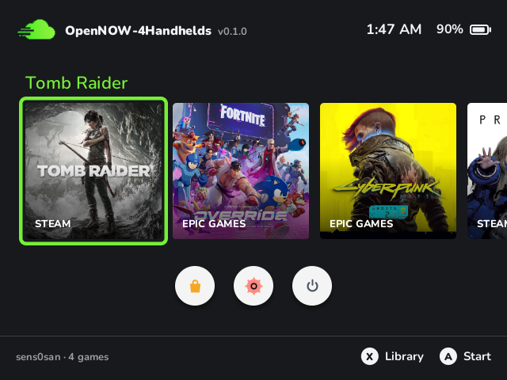
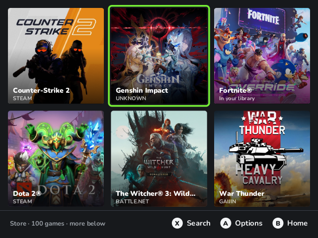
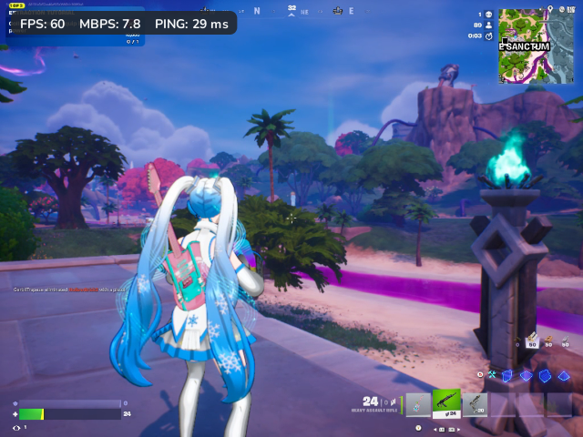
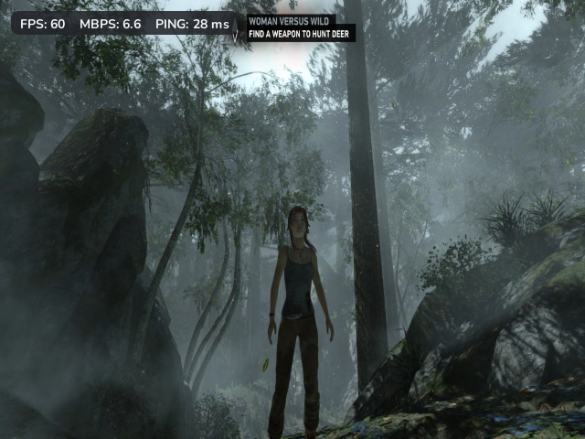

# OpenNOW-4Handhelds
Port of the open source GeForce NOW custom client [OpenNOW](https://github.com/OpenCloudGaming/OpenNOW) for devices such as the R36S and other RK3326 devices.
> At the moment support is only for [dArkOS](https://github.com/christianhaitian/dArkOS) and other versions of it, tests have been done on a clone R36S 1GB of ram running [dArkOS4Clone](https://github.com/lcdyk0517/arkos4clone), more to come.

## Screenshots

| Menu | Store |
| :---: | :---: |
| [](https://github.com/OpenCloudGaming/OpenNOW-4Handhelds/blob/main/screenshots/screenmenu.png "screenmenu.png") | [](https://github.com/OpenCloudGaming/OpenNOW-4Handhelds/blob/main/screenshots/screenstore.png "screenstore.png") |

| Fortnite | Tomb Raider |
| :---: | :---: |
|  |  |

## How to install
Download latest release, extract the contents into the ports folder, on the handheld run OpenNOW, enjoy !
## What you can do
- Sign in with a GeForce NOW account and start playing games from your library.
- Browse the store section and add games to your library.
- Choose a default store for a game, or remove the game from your library.
- Change the server, bit rate, frame rate, resolution, render, vsync to on or off, and controller layout.

## Shortcuts
**FN** or **Select + X** opens the session menu. **Stats** at the bottom of that menu shows FPS and Mbps on the picture.

**Start** and **Select** together quit OpenNOW while in menu, it does not apply while in a session

## Build from source
The scripts build the R36S port only. Both produce `builds/r36s/dist`.
Install Rust, then:
```sh
rustup target add aarch64-unknown-linux-gnu
python3 -m pip install --user ziglang
cargo install cargo-zigbuild --locked
```
On Linux:
```sh
git clone https://github.com/dpadGuy/OpenNOW-4Handhelds.git
cd OpenNOW-4Handhelds
./build.sh
```
On Windows, from the same checkout:
```powershell
./build.ps1
```
`cargo-zigbuild` targets glibc 2.36 so the binaries run on dArkOS. On the handheld itself, `./build.sh` can use the device's own Rust toolchain when Zig is not installed.
On Windows, the compile cache stays inside the project when the folder path has no spaces. If the path contains a space, the script stores the cache at `C:\OpenNOW-r36s` and says so. The ports folder is still `builds\r36s\dist`.
## How it works
The handheld UI is a small Rust program. It starts `opennow-core` for sign-in, the catalog, and session setup, and loads the streamer from `opennow/libraries`. Video is decoded with Rockchip MPP and drawn in the same window as the menus.
```text
opennow-handheld/    Controller UI and the Ports launcher
opennow-core/        Accounts, settings, catalog, and sessions
opennow-streamer/    NVST transport, input, and Rockchip MPP decode
third_party/         Rockchip libraries shipped with the port
build.ps1            R36S build on Windows
build.sh             R36S build on Linux
```

# Acknowledgements
- [OpenNOW](https://github.com/OpenCloudGaming/OpenNOW), amazing project ^_^
- [GreenOvercast](https://github.com/Producdevity/GreenOvercast) for giving an understanding on how to take advantage of hardware acceleration.
- [Moonlight Embedded](https://github.com/moonlight-stream/moonlight-embedded)

## License
MIT. Copyright (c) 2025 Zortos. See [LICENSE](LICENSE).
